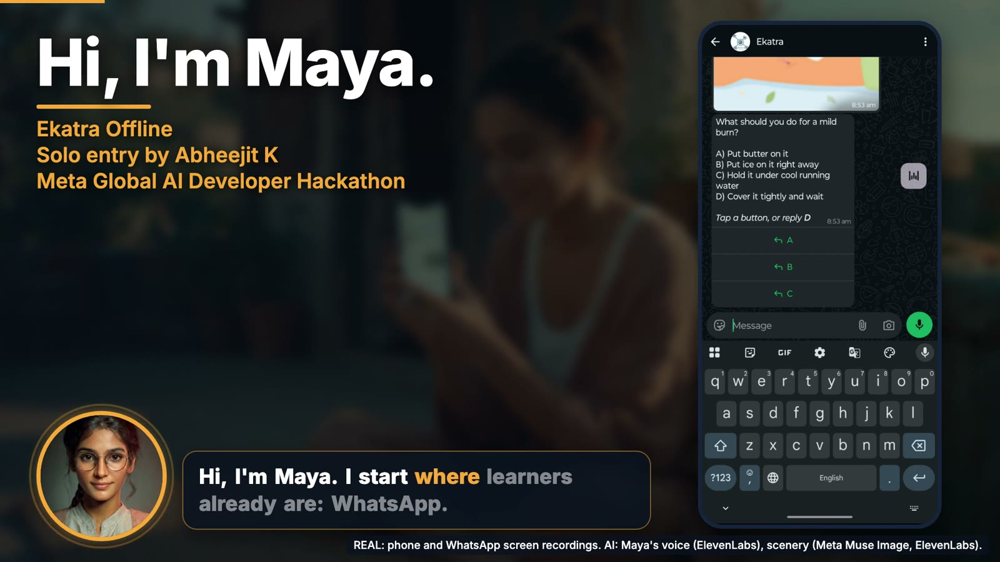
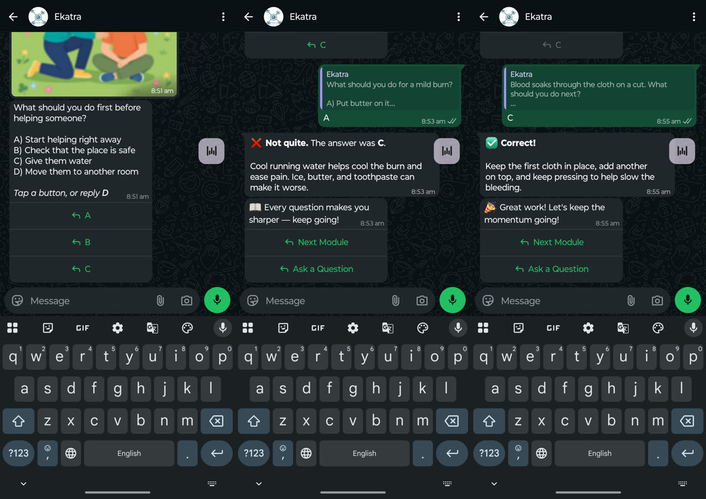
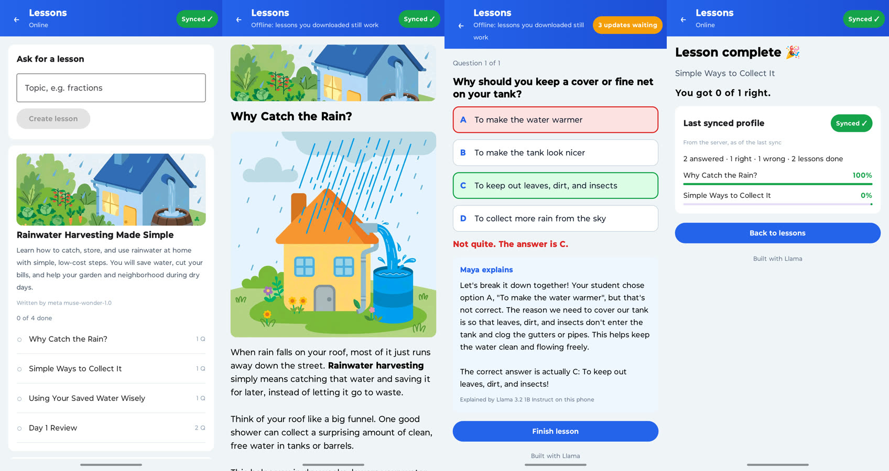

# Ekatra Offline: get aMUSEd with Maya

**An AI tutor that keeps teaching when the network doesn't.** WhatsApp for reach, a phone app with a Llama on board for the places the signal never reaches. Meta's Muse models write the lessons in the cloud; Llama explains the answers on the ground.



## Try it now (no build)

| | |
|---|---|
| **WhatsApp** | Message **+1 254 655 3377** (demo number). Pick a topic and Maya writes your course: pictures, quiz buttons, a review, a certificate.<br><br><br>_Scan to start, or open [wa.me/12546553377](https://wa.me/12546553377?text=Get%20Started%20with%20Maya)_ |
| **Android app (hackathon build)** | Download the APK from the [`hackathon-submission-apk-1` release](https://github.com/ekatraone/ekatra-android-oss/releases/tag/hackathon-submission-apk-1). This is the public demo APK judges install. |
| **Google Play** | [Maya AI on Google Play](https://play.google.com/store/apps/details?id=org.ekatra.alfred) is the chat tutor; an update is in progress. The Play version today does not include the Lessons, the Muse-written lessons or the images: those are in the APK above. |

APK notes: arm64 phone, Android 7 or later. It is debug-signed, so uninstall Maya from Google Play first. On first run it downloads Llama 3.2 1B (about 808 MB) over Wi-Fi. The demo learner access expires on 22 November 2026.

## Why this exists

Most learners we work with have a phone but little or unreliable data. Most AI tutors need a connection for every answer, so they stop in exactly the places that need them. Ekatra grew out of work in remote geographies and is being deployed with refugee communities. Our story was featured in the inaugural episode of #BharatBuildsWithLlama. This project is the missing half: **learning with no barriers, from the grassroots up.**

## What you get

| Feature | What it does | Why it matters |
|---|---|---|
| **WhatsApp-first tutor** | Learn inside the chat: pick a topic, get a course with pictures, quizzes, a day-end review and a PDF certificate. | Nothing to install, runs on almost any phone, messages wait for the signal. |
| **Lessons written by Meta's Muse** | Muse Wonder writes a short lesson and quiz on any topic; Muse Image draws a cover and a picture per module. About a minute. | Any topic, any learner, no content team. |
| **Offline lessons in the Maya app** | The lesson, its pictures and the answer keys are stored on the phone. Reading and quizzes work in airplane mode, graded on the phone. | A lesson that survives a dead zone. |
| **Llama 3.2 1B on the phone** | When an answer is wrong, a Llama running on the device explains why, with no network. | Help at the exact moment of confusion, even offline. |
| **Sync that never double-counts** | Answers and even a new topic request wait in a local queue and sync on reconnect. The server regrades every answer from its own key. | Safe progress, one learner profile. |
| **One backend, two channels** | WhatsApp and the app run on the same backend and lesson engine. | Reach on WhatsApp, depth in the app. |





*Real screenshots from the hackathon build (WhatsApp demo number and the Android APK).*

## How it works

```
 WhatsApp learner ---- Twilio ----+                      +---- Meta Model API ----+
                                  v                      |  Muse Wonder (lesson)  |
 Maya app ---- sync API ----> Ekatra backend ------------+  Muse Image (pictures) |
   |  Llama 3.2 1B on the phone      (Node, PostgreSQL)   +------------------------+
   |  lessons + answer keys stored locally, queue syncs on reconnect
```

| Meta model | Used for | Where it runs |
|---|---|---|
| **Muse Wonder** | Writes the micro-lesson, quiz, answers and explanations | Meta Model API, called by the backend |
| **Muse Image** | Cover and per-module pictures | Meta Model API, called by the backend |
| **Llama 3.2 1B Instruct** | Explains answers on the phone, offline | On the device, via llama.cpp |

**Only Meta models are called at runtime.** A `META_ONLY` switch turns off every other AI provider in the backend, and the submitted demo runs with only the Meta key configured. Details: [docs/DISCLOSURE.md](docs/DISCLOSURE.md).

## What existed before, and what we built this week

- **Before the event:** Ekatra's WhatsApp and Telegram micro-learning platform (course generator, scheduler, admin) and the Maya Android chat app with an on-device model. Their code is in two separate base repositories: [ekatra-platform-base](https://github.com/ekatraone/ekatra-platform-base) and [ekatra-maya-android-base](https://github.com/ekatraone/ekatra-maya-android-base).
- **This week (this repository only):** the Meta Model API integration (Muse Wonder and Muse Image), on-demand micro-lessons with pictures, the sync API (lessons, events, profile, account deletion), WhatsApp upgrades (pictures, quiz buttons, one-at-a-time review, PDF certificate), and in the app the Lessons screens, the offline lesson store, the sync queue and Llama 3.2 1B with its prompt format.
- The full commit-by-commit table is in [docs/PRIOR_VS_NEW.md](docs/PRIOR_VS_NEW.md); the architecture is in [docs/ARCHITECTURE.md](docs/ARCHITECTURE.md).

## Run it yourself

<details>
<summary>Short version (full clean-machine steps in <a href="docs/SETUP.md">docs/SETUP.md</a>)</summary>

Needs Node 22.18.x, pnpm 10.28.1, PostgreSQL 14+ and git. For the Android app: JDK 17 and the Android SDK/NDK.

```
git clone https://github.com/ekatraone/ekatra-offline-hackathon
git clone https://github.com/ekatraone/ekatra-platform-base
git clone --recurse-submodules https://github.com/ekatraone/ekatra-maya-android-base

cd ekatra-offline-hackathon
scripts/apply_overlay.sh --backend ../ekatra-platform-base --android ../ekatra-maya-android-base

cd ../ekatra-platform-base
cp ../ekatra-offline-hackathon/.env.example .env     # add your Meta key, see below
npx pnpm@10.28.1 install --frozen-lockfile && npx pnpm@10.28.1 build:packages
createdb ekatra && export DATABASE_URL=postgres://localhost/ekatra DATABASE_DISABLE_SSL=true
npx pnpm@10.28.1 db:migrate
(cd apps/backend && NODE_ENV=test npx pnpm@10.28.1 test)     # 295 tests
npx pnpm@10.28.1 dev
```

Add your key in `.env` (never commit it). Configure only the Meta key:

```
MODEL_API_KEY=<your Meta Model API key>
META_MODEL_ID=muse-wonder-1.0
META_IMAGE_MODEL_ID=muse-image-1.0
META_ONLY=1
```

Android: copy the two `google-services.json.example` files and fill them from your Firebase project, put `SYNC_BASE_URL` and `DEMO_LEARNER_TOKEN` (printed by `apps/backend/src/scripts/issueDemoLearner.ts`) in `local.properties`, then `./gradlew :app:assembleMayaDebug`.

</details>

## Disclosure

- **Pre-existing code** lives in the two base repositories above (sanitised single-commit snapshots); it is not in this repo.
- **Third-party:** llama.cpp (MIT), Llama 3.2 1B Instruct weights under the Llama 3.2 Community License (downloaded by the app, not redistributed here), a bartowski GGUF quantization, Firebase sign-in and Twilio (not AI models).
- **AI-generated assets:** the Maya portrait in the app was generated with Google Gemini and predates the event. The demo video's voiceover is ElevenLabs; its scenery is AI-generated (Meta Muse Image and ElevenLabs) and labelled as such in the video. The video's script was drafted with Muse Wonder and edited by us.
- **Non-Meta models in the app's catalog:** the pre-existing Android model catalog also lists a few non-Meta models (for example Gemma, Qwen, Phi-3, Liquid). They are not used by default: the app downloads Llama 3.2 1B. Full detail in [docs/DISCLOSURE.md](docs/DISCLOSURE.md).
- **Built with Claude Code.** Much of the code in the event commits was written with Claude Code, as the commit trailers show. Meta's models are what the product runs on.

## License

MIT, see [LICENSE](LICENSE). **Built with Llama.** Llama 3.2 is licensed under the Llama 3.2 Community License, Copyright © Meta Platforms, Inc. All Rights Reserved.
